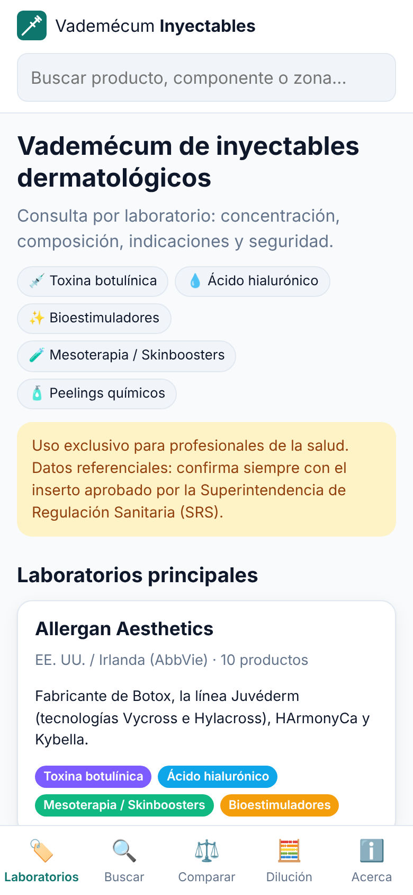
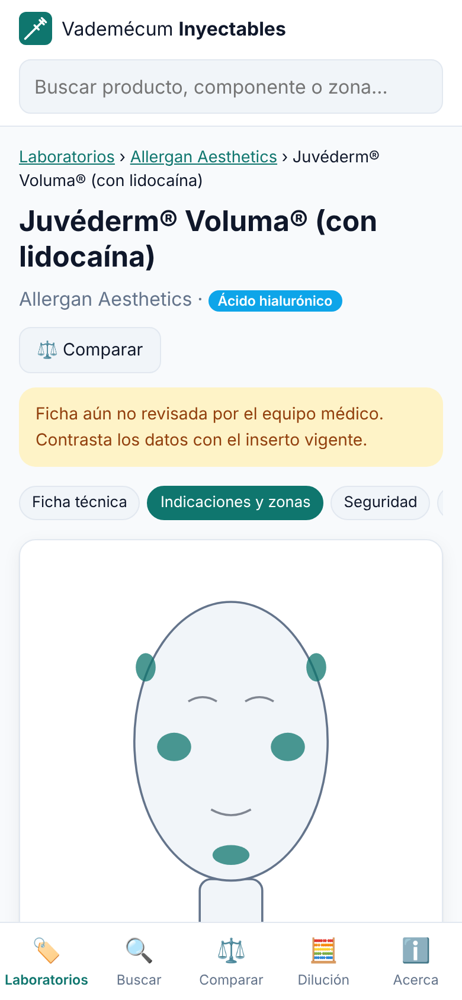
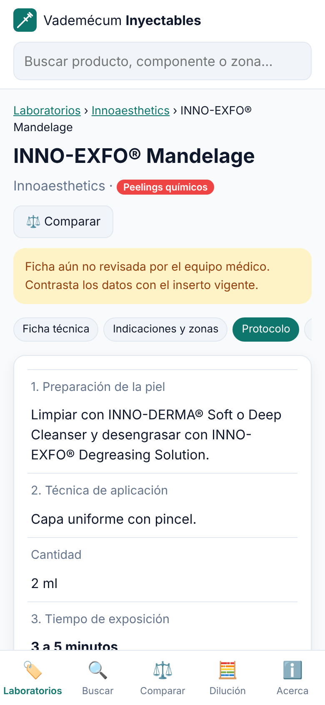

# Vademécum de inyectables dermatológicos — El Salvador

App web (PWA, funciona sin conexión) para médicos: productos inyectables y peelings
organizados por laboratorio, con concentración, composición, características,
indicaciones/zonas, seguridad y evidencia clínica.

## Capturas

| Inicio | Ficha y zonas | Protocolo de peeling |
|---|---|---|
|  |  |  |

## Funciones

- **Laboratorios**: Allergan, Merz, Innoaesthetics, Croma, Medytox (NEWLUX®), REGEN Biotech
  (AestheFill®, PowerFill®) y Toskani, más laboratorios sugeridos
  (Galderma, Teoxane, IBSA, Sinclair, Hugel, Fillmed, Mastelli y mesoestetic), cuyo registro
  en la SRS debe confirmarse.
- **Categorías**: toxina botulínica, ácido hialurónico, bioestimuladores,
  mesoterapia/skinboosters y peelings químicos.
- **Ficha de producto** con cuatro pestañas: ficha técnica, indicaciones y zonas (con mapa facial),
  seguridad (contraindicaciones, efectos adversos, manejo de complicaciones) y evidencia
  (PubMed y ClinicalTrials.gov).
- **Buscador y filtros** por texto, categoría, laboratorio, zona y lidocaína.
- **Comparador** de hasta 3 productos lado a lado.
- **Calculadora de dilución** de toxina (U/0.1 ml, marcas de jeringa U-100, cálculo inverso).

## Uso

No necesita instalación ni compilación. Abre `index.html` o sírvela como sitio estático:

```bash
python3 -m http.server 8000   # luego abre http://localhost:8000
```

Se publica sola en GitHub Pages con `.github/workflows/pages.yml` (requisito único: Settings → Pages → Source: «GitHub Actions»). Dirección: https://mauperdomo.github.io/medicinaesteticaelsalvador/
En el celular: «Agregar a pantalla de inicio».

## App móvil

### Android (APK)

El proyecto Android está en `android/` (Capacitor 6, paquete `sv.medicinaestetica.vademecum`).
Cada push compila el APK con GitHub Actions (`.github/workflows/android.yml`) y lo publica en la
versión **android-latest** del repositorio, desde donde se descarga directamente en el celular.

Compilar en local (requiere Node 20+, JDK 17+ y el SDK de Android):

```bash
npm ci
npm run android:apk        # genera android/app/build/outputs/apk/debug/app-debug.apk
```

Tras cambiar la app web, `npm run android:sync` copia los archivos a `www/` y al proyecto Android.
Para publicar en Google Play hace falta firmar un AAB de release con una clave propia
(`./gradlew bundleRelease`) y una cuenta de desarrollador.

### iPhone

Ábrela en Safari y elige **Compartir → Agregar a pantalla de inicio**: se instala como app a
pantalla completa y funciona sin conexión. Una app nativa para la App Store requiere una Mac con
Xcode y una cuenta de Apple Developer (`npx cap add ios`).

## Editar o agregar productos

Todos los datos están en `data/productos.js`. Cada producto tiene este formato:

```js
{
  id: "identificador-unico",
  lab: "merz",                 // id del laboratorio
  nombre: "Nombre comercial",
  categoria: "ha",             // toxina | ha | bioestimulador | meso | peeling
  principioActivo: "...",
  concentracion: "20 mg/ml",   // null → se muestra "Verificar en ficha técnica"
  composicion: "...",
  lidocaina: true,
  indicaciones: ["..."],
  zonas: ["labios", "ojeras"], // claves de `zonas`
  revisado: false,             // cambiar a true cuando el médico lo valide contra el inserto
  // opcionales: tecnologia, presentacion, caracteristicas, dilucion, dosis, plano, aguja,
  // duracion, conservacion, aprobaciones, seguridadExtra, evidencia: [{ titulo, url }]
}
```

Después de cambiar los datos, actualiza `version` en `data/productos.js` y `CACHE` en `sw.js`
para que los usuarios reciban la nueva versión.

## Aviso

Herramienta de consulta para profesionales de la salud. Los datos se recopilaron de fichas
técnicas e insertos internacionales y **deben verificarse** contra el inserto aprobado por la
[Superintendencia de Regulación Sanitaria](https://www.srs.gob.sv). Las fichas de Innoaesthetics
(INNO-TDS® e INNO-EXFO®) provienen de los catálogos oficiales del laboratorio y citan la página de origen;
algunos campos de otros laboratorios aparecen marcados como pendientes de verificar.
